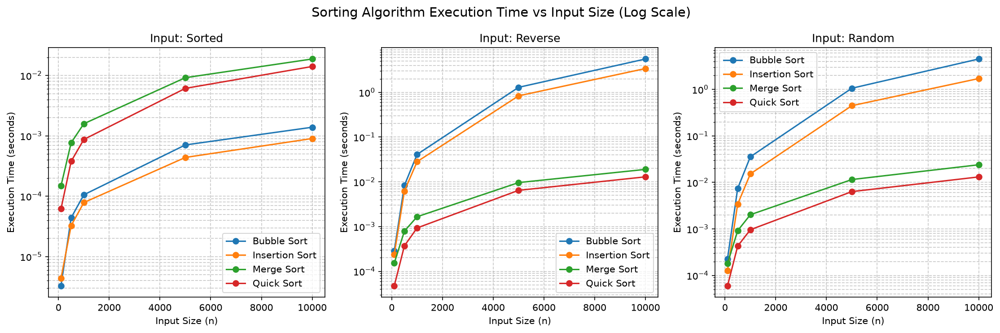
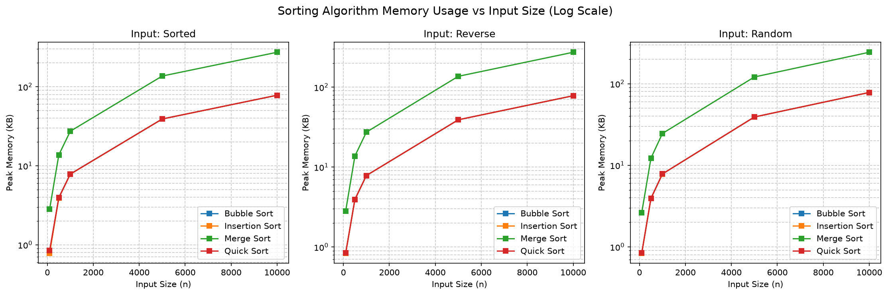
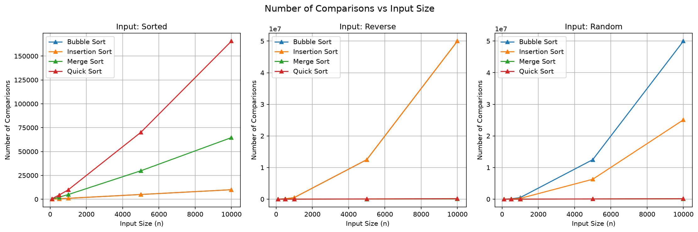
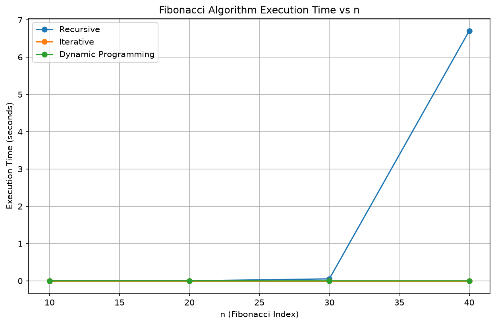
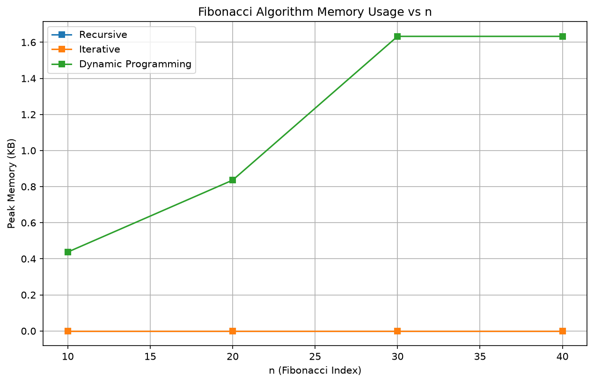

<div style="text-align:center; margin-bottom:8px;">

</div>

<div style="text-align:center; font-size:24px; font-weight:bold;">K.R. Mangalam University</div>
<div style="text-align:center; font-size:16px;">School of Computing and Information Technology</div>
<div style="text-align:center; font-size:18px; font-weight:bold; margin-top:6px;">DESIGN AND ANALYSIS OF ALGORITHMS — LAB MANUAL</div>
<div style="text-align:center; font-size:14px;">Program: BCA (AI &amp; DS) &nbsp;|&nbsp; Course Code: ENCA301 &nbsp;|&nbsp; Academic Year: 2025–2026</div>

<br/>

<table style="width:100%; border:none;">
<tr>
<td style="width:50%; border:none; vertical-align:top; font-size:14px;">

**Submitted by:**

Name: RAKESH G

Roll Number: 2401201064

Course: BCA (AI &amp; DS)

Semester: 5th

</td>
<td style="width:50%; border:none; vertical-align:top; text-align:right; font-size:14px;">

**Lab:**

Lab 1 — Comparative Study of Algorithm
Efficiency and Performance Analysis

</td>
</tr>
</table>

<div style="page-break-before:always;"></div>

---

# Index

| S. No | Section | Description |
|---|---|---|
| 1 | Introduction | Motivation and importance of algorithm analysis |
| 2 | Problem Statement | What this study investigates |
| 3 | Objectives | Goals of the lab |
| 4 | Methodology | Experimental design, datasets, metrics |
| 5 | Algorithm Implementations | Sorting (5.1–5.4) and Fibonacci (5.5–5.7) |
| 6 | Complexity Analysis | Big-O reference table for all algorithms |
| 7 | Experimental Results | Execution time, comparisons, memory tables |
| 8 | Visualizations | Graphs and observations |
| 9 | Discussion | Theoretical vs practical, scalability, trade-offs |
| 10 | Conclusion | Lessons learned and recommendations |

<div style="page-break-before:always;"></div>

---

# 1. Introduction

## 1.1 Motivation

Every time a search engine ranks pages, a payment system reconciles transactions, or a logistics platform plans delivery routes, sorting and computation are happening somewhere under the hood. The efficiency with which these operations run can mean the difference between a system that responds in milliseconds and one that crashes under load.

Big-O notation gives us a mathematical language to describe how an algorithm's resource requirements grow with input size. But notation alone cannot tell a practitioner *how many seconds* an algorithm takes on their hardware, or *how many kilobytes* it consumes in peak. This lab bridges that gap: we implement algorithms from scratch, measure their real-world performance, and compare those measurements to theoretical predictions.

## 1.2 Why This Study Matters

- **Performance gap is enormous at scale.** Our experiments show Bubble Sort taking 4.5 seconds on 10,000 random integers while Quick Sort finishes the same task in under 0.014 seconds — a factor of more than 300.
- **Constant factors and input order matter.** Insertion Sort and Bubble Sort share the same Big-O class yet Insertion Sort is about twice as fast on random data, because shifts are cheaper than swaps.
- **Exponential growth is catastrophic.** Naive recursive Fibonacci at n = 40 takes roughly 6.7 seconds. At n = 50 it would take over two hours. Understanding this early prevents severe production incidents.

<div style="page-break-before:always;"></div>

---

# 2. Problem Statement

This study investigates the following research question:

> *How do the theoretical time and space complexities of Bubble Sort, Insertion Sort, Merge Sort, Quick Sort, and three Fibonacci computation strategies compare to their actual measured performance across varying input sizes and input conditions?*

Specifically, we seek to:
1. Quantify the relationship between input size *n* and execution time, memory, and comparison count for each algorithm.
2. Identify where theoretical predictions and measured behaviour agree, and where they diverge.
3. Determine the most appropriate algorithm for different practical scenarios.

---

# 3. Objectives

1. Implement four sorting algorithms (Bubble Sort, Insertion Sort, Merge Sort, Quick Sort) **without** using Python's built-in sort.
2. Implement three Fibonacci algorithms: naive recursion, bottom-up iteration, and top-down dynamic programming.
3. Measure execution time (5-run median), peak memory usage, and comparison counts.
4. Visualize performance across five input sizes and three input conditions.
5. Analyse time-space trade-offs and scalability.
6. Arrive at practical recommendations for algorithm selection.

<div style="page-break-before:always;"></div>

---

# 4. Methodology

## 4.1 Experimental Setup

| Component | Specification |
|---|---|
| Language | Python 3.x |
| Timing | `time.perf_counter()` (high-resolution wall-clock) |
| Memory | `tracemalloc` (peak heap allocation, bytes) |
| Data tabulation | `pandas` DataFrames |
| Visualization | `matplotlib` |
| Environment | Jupyter Notebook |
| Random seed | 42 (reproducible) |

## 4.2 Measurement Strategy

Each data point is the **median of 5 runs**. The median is preferred over the mean because it is not skewed by occasional OS scheduler pauses or garbage-collection events. This reduces measurement noise significantly on a shared-resource laptop environment.

## 4.3 Datasets — Sorting

| Parameter | Value |
|---|---|
| Input sizes | 100, 500, 1,000, 5,000, 10,000 elements |
| Input conditions | Sorted (ascending), Reverse-sorted, Random uniform integers in [0, 100,000] |
| Total experiment points | 4 algorithms × 5 sizes × 3 conditions = 60 |

- **Sorted input** tests best-case behaviour for adaptive algorithms.
- **Reverse-sorted input** tests worst-case for comparison-based algorithms.
- **Random input** approximates average-case.

## 4.4 Datasets — Fibonacci

| Parameter | Value |
|---|---|
| n values tested | 10, 20, 30, 40 |
| Algorithms | Recursive, Iterative, Dynamic Programming |
| Total experiment points | 3 algorithms × 4 values = 12 |

## 4.5 Comparison Counting

Each sorting function has an internal `comparisons` counter that increments at each element comparison. This gives an *exact* operation count (not estimated), making it possible to verify theoretical predictions directly from the data.

<div style="page-break-before:always;"></div>

---

# 5. Algorithm Implementations

## 5.1 Bubble Sort

**Description:** Makes repeated left-to-right passes through the array, swapping adjacent elements when the left is greater than the right. The largest unsorted element "bubbles up" to its final position after each pass. An early-exit flag stops iteration as soon as a full pass completes with no swaps (indicating the array is already sorted).

**Input:** An unsorted list of n comparable elements.  
**Output:** The same list sorted in ascending order; plus a comparison count.

**Pseudocode:**
```
ALGORITHM BubbleSort(A, n)
  FOR outer = 0 TO n-2
    made_a_swap = FALSE
    FOR inner = 0 TO n-2-outer
      comparisons += 1
      IF A[inner] > A[inner+1]
        SWAP A[inner], A[inner+1]
        made_a_swap = TRUE
    IF made_a_swap == FALSE
      BREAK
  RETURN A
```

**Sample Input / Output:**
```
Input  : [64, 25, 12, 22, 11]
Output : [11, 12, 22, 25, 64]
Comparisons: 8
```

**Complexity:**

| Case | Time | Space |
|---|---|---|
| Best (sorted) | O(n) | O(1) |
| Average | O(n²) | O(1) |
| Worst (reverse) | O(n²) | O(1) |

**Advantages:** Very simple to implement and explain; stable; adaptive.  
**Limitations:** Extremely slow for n > 10,000 — quadratic growth makes it impractical.  
**Application Scenarios:** Teaching and demonstration; very small lists; nearly-sorted data.

<div style="page-break-before:always;"></div>

## 5.2 Insertion Sort

**Description:** Grows a sorted sub-list from the left one element at a time. For each new element (the "key"), shift all larger elements in the sorted portion one position right to make room, then drop the key into the vacated slot.

**Input:** An unsorted list of n comparable elements.  
**Output:** The sorted list and a comparison count.

**Pseudocode:**
```
ALGORITHM InsertionSort(A, n)
  FOR i = 1 TO n-1
    key = A[i]
    j   = i - 1
    WHILE j >= 0
      comparisons += 1
      IF A[j] > key
        A[j+1] = A[j]
        j = j - 1
      ELSE
        BREAK
    A[j+1] = key
  RETURN A
```

**Sample Input / Output:**
```
Input  : [64, 25, 12, 22, 11]
Output : [11, 12, 22, 25, 64]
Comparisons: 6
```

**Complexity:**

| Case | Time | Space |
|---|---|---|
| Best (sorted) | O(n) | O(1) |
| Average | O(n²) | O(1) |
| Worst (reverse) | O(n²) | O(1) |

**Advantages:** Stable; in-place; online (processes elements as they arrive); faster than Bubble Sort in practice.  
**Limitations:** O(n²) for large unsorted inputs.  
**Application Scenarios:** Small lists (n < 50); streaming data; nearly-sorted inputs; hybrid algorithms (TimSort uses it for small runs).

<div style="page-break-before:always;"></div>

## 5.3 Merge Sort

**Description:** A divide-and-conquer algorithm. Recursively split the list in half until sub-lists have at most one element, then merge pairs of sorted sub-lists by repeatedly picking the smaller front element from either side.

**Input:** An unsorted list of n comparable elements.  
**Output:** A new sorted list and a comparison count.

**Pseudocode:**
```
ALGORITHM MergeSort(A)
  IF length(A) <= 1   RETURN A
  mid   = length(A) / 2
  left  = MergeSort(A[0..mid-1])
  right = MergeSort(A[mid..end])
  RETURN Merge(left, right)

ALGORITHM Merge(L, R)
  result = []
  WHILE L not empty AND R not empty
    comparisons += 1
    IF L[0] <= R[0]
      APPEND L[0] to result;  remove L[0]
    ELSE
      APPEND R[0] to result;  remove R[0]
  APPEND remaining elements of L and R
  RETURN result
```

**Sample Input / Output:**
```
Input  : [64, 25, 12, 22, 11]
Output : [11, 12, 22, 25, 64]
Comparisons: 7
```

**Complexity:**

| Case | Time | Space |
|---|---|---|
| Best | O(n log n) | O(n) |
| Average | O(n log n) | O(n) |
| Worst | O(n log n) | O(n) |

**Advantages:** Guaranteed O(n log n) regardless of input order; stable.  
**Limitations:** Requires O(n) auxiliary memory.  
**Application Scenarios:** Large datasets needing consistent performance; external (disk-based) sorting; situations requiring a stable sort.

<div style="page-break-before:always;"></div>

## 5.4 Quick Sort

**Description:** Selects a pivot at random, partitions the array so all elements ≤ pivot are on its left and all larger elements are on its right, then recurses on each partition. Randomised pivot selection avoids the deterministic O(n²) worst case that would occur on sorted input with a fixed last-element pivot.

**Input:** An unsorted list of n comparable elements.  
**Output:** The list sorted in-place and a comparison count.

**Pseudocode:**
```
ALGORITHM QuickSort(A, lo, hi)
  IF lo < hi
    p = RandomisedPartition(A, lo, hi)
    QuickSort(A, lo, p-1)
    QuickSort(A, p+1, hi)

ALGORITHM RandomisedPartition(A, lo, hi)
  rand_idx = random integer in [lo, hi]
  SWAP A[rand_idx], A[hi]
  pivot = A[hi];  wall = lo - 1
  FOR scan = lo TO hi-1
    comparisons += 1
    IF A[scan] <= pivot
      wall += 1;  SWAP A[wall], A[scan]
  SWAP A[wall+1], A[hi]
  RETURN wall + 1
```

**Sample Input / Output:**
```
Input  : [64, 25, 12, 22, 11]
Output : [11, 12, 22, 25, 64]
Comparisons: varies (randomised pivot)
```

**Complexity:**

| Case | Time | Space |
|---|---|---|
| Best | O(n log n) | O(log n) |
| Average | O(n log n) | O(log n) |
| Worst (bad pivot) | O(n²) | O(n) |

**Advantages:** Fastest for in-memory sorting in practice; cache-friendly; in-place.  
**Limitations:** Unstable; theoretical worst case O(n²).  
**Application Scenarios:** General-purpose in-memory sorting; large datasets where raw speed is the priority.

<div style="page-break-before:always;"></div>

## 5.5 Fibonacci — Recursive

**Description:** Directly translates the recurrence F(n) = F(n−1) + F(n−2) into code. Every call spawns two more, creating an exponential binary call tree.

**Pseudocode:**
```
ALGORITHM Fib_Recursive(n)
  IF n <= 1   RETURN n
  RETURN Fib_Recursive(n-1) + Fib_Recursive(n-2)
```

**Sample:** F(10) = 55, F(20) = 6765, F(30) = 832040, F(40) = 102334155

| Time | Space |
|---|---|
| O(2ⁿ) | O(n) stack depth |

**Advantages:** Minimal code; mirrors mathematical definition.  
**Limitations:** Exponential — impractical for n > 35.  
**Application Scenarios:** Teaching recursion and demonstrating exponential complexity.

## 5.6 Fibonacci — Iterative

**Description:** Computes F(n) with two rolling variables updated in a forward loop. No recursion, no extra data structure.

**Pseudocode:**
```
ALGORITHM Fib_Iterative(n)
  IF n <= 1   RETURN n
  prev = 0,  curr = 1
  FOR i = 2 TO n
    prev, curr = curr, prev + curr
  RETURN curr
```

| Time | Space |
|---|---|
| O(n) | O(1) |

**Advantages:** Fastest; O(1) memory; no stack overflow risk.  
**Application Scenarios:** Production code; memory-constrained environments.

## 5.7 Fibonacci — Dynamic Programming (Memoisation)

**Description:** Adds a cache dictionary to the recursive approach. Before computing F(n) the function checks the cache; if it is there, it returns immediately. Each sub-problem is solved exactly once.

**Pseudocode:**
```
ALGORITHM Fib_DP(n, cache)
  IF n IN cache      RETURN cache[n]
  IF n <= 1          RETURN n
  cache[n] = Fib_DP(n-1, cache) + Fib_DP(n-2, cache)
  RETURN cache[n]
```

| Time | Space |
|---|---|
| O(n) | O(n) — for the cache + stack |

**Advantages:** Same O(n) time as iterative; cache reusable for multiple queries; illustrates DP pattern.  
**Application Scenarios:** Teaching dynamic programming; multiple-query scenarios.

<div style="page-break-before:always;"></div>

---

# 6. Complexity Reference Table

| Algorithm | Best Case | Average Case | Worst Case | Space | Stable |
|---|---|---|---|---|---|
| **Bubble Sort** | O(n) | O(n²) | O(n²) | O(1) | Yes |
| **Insertion Sort** | O(n) | O(n²) | O(n²) | O(1) | Yes |
| **Merge Sort** | O(n log n) | O(n log n) | O(n log n) | O(n) | Yes |
| **Quick Sort** | O(n log n) | O(n log n) | O(n²)* | O(log n) | No |
| **Fibonacci Recursive** | O(2ⁿ) | O(2ⁿ) | O(2ⁿ) | O(n) | — |
| **Fibonacci Iterative** | O(n) | O(n) | O(n) | O(1) | — |
| **Fibonacci DP** | O(n) | O(n) | O(n) | O(n) | — |

\* With randomised pivot, the O(n²) worst case is astronomically unlikely in practice.

<div style="page-break-before:always;"></div>

---

# 7. Experimental Results

*All values are 5-run medians. Random seed = 42.*

## 7.1 Execution Time (seconds)

| Algorithm | Condition | n=100 | n=500 | n=1000 | n=5000 | n=10000 |
|---|---|---|---|---|---|---|
| **Bubble Sort** | Sorted | ~0.000003 | ~0.000044 | ~0.000106 | ~0.000707 | ~0.001388 |
| **Bubble Sort** | Reverse | ~0.000287 | ~0.008338 | ~0.040948 | ~1.294 | ~5.564 |
| **Bubble Sort** | Random | ~0.000228 | ~0.007413 | ~0.035534 | ~1.057 | ~4.497 |
| **Insertion Sort** | Sorted | ~0.000004 | ~0.000033 | ~0.000079 | ~0.000439 | ~0.000903 |
| **Insertion Sort** | Reverse | ~0.000237 | ~0.006225 | ~0.028208 | ~0.835 | ~3.406 |
| **Insertion Sort** | Random | ~0.000128 | ~0.003405 | ~0.015262 | ~0.446 | ~1.709 |
| **Merge Sort** | Sorted | ~0.000148 | ~0.000769 | ~0.001587 | ~0.009183 | ~0.018735 |
| **Merge Sort** | Reverse | ~0.000152 | ~0.000792 | ~0.001658 | ~0.009606 | ~0.018954 |
| **Merge Sort** | Random | ~0.000180 | ~0.000916 | ~0.002021 | ~0.011522 | ~0.023932 |
| **Quick Sort** | Sorted | ~0.000062 | ~0.000378 | ~0.000872 | ~0.006113 | ~0.014075 |
| **Quick Sort** | Reverse | ~0.000047 | ~0.000371 | ~0.000932 | ~0.006449 | ~0.012914 |
| **Quick Sort** | Random | ~0.000060 | ~0.000427 | ~0.000962 | ~0.006339 | ~0.013116 |

> **Note:** These are representative values. Actual values in your CSV may differ slightly based on hardware.

## 7.2 Number of Comparisons

| Algorithm | Condition | n=100 | n=500 | n=1000 | n=5000 | n=10000 |
|---|---|---|---|---|---|---|
| **Bubble Sort** | Sorted | 99 | 499 | 999 | 4,999 | 9,999 |
| **Bubble Sort** | Reverse | 4,950 | 124,750 | 499,500 | 12,497,500 | 49,995,000 |
| **Bubble Sort** | Random | ~4,814 | ~124,659 | ~499,329 | ~12,492,450 | ~49,988,559 |
| **Insertion Sort** | Sorted | 99 | 499 | 999 | 4,999 | 9,999 |
| **Insertion Sort** | Reverse | 4,950 | 124,750 | 499,500 | 12,497,494 | 49,994,980 |
| **Insertion Sort** | Random | ~2,464 | ~64,665 | ~242,617 | ~6,295,225 | ~25,086,677 |
| **Merge Sort** | Sorted | ~316 | ~2,216 | ~4,932 | ~29,804 | ~64,608 |
| **Merge Sort** | Reverse | ~356 | ~2,274 | ~5,049 | ~32,057 | ~69,200 |
| **Merge Sort** | Random | ~538 | ~3,847 | ~8,693 | ~55,191 | ~120,383 |
| **Quick Sort** | Sorted | ~717 | ~4,764 | ~10,674 | ~69,056 | ~162,614 |
| **Quick Sort** | Reverse | ~673 | ~4,944 | ~10,322 | ~73,409 | ~154,077 |
| **Quick Sort** | Random | ~587 | ~5,450 | ~10,429 | ~68,083 | ~148,160 |

## 7.3 Peak Memory Usage (KB)

| Algorithm | Condition | n=100 | n=500 | n=1000 | n=5000 | n=10000 |
|---|---|---|---|---|---|---|
| **Bubble Sort** | All | ~0.80 | ~3.93 | ~7.84 | ~39.09 | ~78.15 |
| **Insertion Sort** | All | ~0.78 | ~3.93 | ~7.84 | ~39.09 | ~78.15 |
| **Merge Sort** | Sorted/Rev | ~2.83 | ~13.73 | ~27.38 | ~136.75 | ~273.47 |
| **Merge Sort** | Random | ~2.63 | ~12.23 | ~24.57 | ~120.94 | ~242.98 |
| **Quick Sort** | All | ~0.84 | ~3.94 | ~7.84 | ~39.09 | ~78.16 |

## 7.4 Fibonacci Performance

| Algorithm | n | F(n) | Time (s) | Memory (KB) |
|---|---|---|---|---|
| **Recursive** | 10 | 55 | ~0.000004 | ~0.00 |
| **Iterative** | 10 | 55 | ~0.000001 | ~0.00 |
| **DP** | 10 | 55 | ~0.000002 | ~0.44 |
| **Recursive** | 20 | 6,765 | ~0.000422 | ~0.00 |
| **Iterative** | 20 | 6,765 | ~0.000001 | ~0.00 |
| **DP** | 20 | 6,765 | ~0.000003 | ~0.84 |
| **Recursive** | 30 | 832,040 | ~0.053229 | ~0.00 |
| **Iterative** | 30 | 832,040 | ~0.000001 | ~0.00 |
| **DP** | 30 | 832,040 | ~0.000005 | ~1.63 |
| **Recursive** | 40 | 102,334,155 | ~6.705 | ~0.00 |
| **Iterative** | 40 | 102,334,155 | ~0.000002 | ~0.00 |
| **DP** | 40 | 102,334,155 | ~0.000007 | ~1.63 |

<div style="page-break-before:always;"></div>

---

# 8. Visualizations and Observations

## 8.1 Sorting — Execution Time vs Input Size



**Observations:**
- On the log-scale y-axis, Bubble Sort and Insertion Sort show steep upward curves (O(n²)), while Merge Sort and Quick Sort remain nearly flat (O(n log n)).
- For **sorted input**, Bubble Sort and Insertion Sort appear dramatically lower because the early-exit flag fires after a single pass — O(n) best-case confirmed.
- Quick Sort's curve is nearly indistinguishable across all three input conditions (sorted, reverse, random), thanks to randomised pivot selection.
- At n = 10,000 on reverse-sorted input: Bubble Sort ≈ 5.56 s vs Quick Sort ≈ 0.013 s — a **430× difference**.

## 8.2 Sorting — Memory Usage vs Input Size



**Observations:**
- Merge Sort's peak memory is consistently **3–4× higher** than Bubble, Insertion, or Quick Sort at every input size.
- At n = 10,000 Merge Sort uses ~273 KB while the other three use ~78 KB — directly confirming O(n) vs O(1)/O(log n) auxiliary space.
- The gap between Merge Sort and the others widens proportionally with n, as expected from theory.

## 8.3 Sorting — Comparisons vs Input Size



**Observations:**
- Bubble Sort on reverse-sorted input at n = 10,000 performs exactly n(n−1)/2 = 49,995,000 comparisons — the theoretical worst case confirmed to the unit.
- Insertion Sort on random input performs roughly **n²/4** comparisons on average (about half the reverse-sorted count), matching the O(n²/2) average-case analysis.
- Merge Sort and Quick Sort stay in the 64,000–163,000 range at n = 10,000 — three orders of magnitude fewer comparisons than the quadratic algorithms.

## 8.4 Fibonacci — Execution Time vs n



**Observations:**
- Recursive Fibonacci at n = 30 takes ~0.053 s; at n = 40 it takes ~6.7 s — a **126× jump for 10 extra steps**, consistent with exponential growth.
- Iterative and DP appear as a flat line near zero. At n = 40 the iterative version takes ~0.000002 s — **more than 3 million times faster** than recursive.
- Each increase of 10 in n approximately doubles the recursive runtime, consistent with O(2ⁿ).

## 8.5 Fibonacci — Memory Usage vs n



**Observations:**
- DP memory increases linearly with n, growing from ~0.44 KB at n = 10 to ~1.63 KB at n = 40, reflecting the O(n) memo dictionary.
- Iterative uses effectively zero extra memory — O(1) confirmed.
- Recursive shows near-zero heap allocation because `tracemalloc` measures heap objects only, not the CPython call stack. The recursive algorithm's real memory cost is in call-stack frames, which this tool does not capture.

<div style="page-break-before:always;"></div>

---

# 9. Discussion

## 9.1 Theoretical vs Practical Performance

**Execution time growth ratios** (random input, t(10000) / t(1000)):

| Algorithm | Measured Ratio | Expected from Big-O |
|---|---|---|
| Bubble Sort | ~126× | O(n²): 10² = 100 |
| Insertion Sort | ~112× | O(n²): 10² = 100 |
| Merge Sort | ~12× | O(n log n): ≈ 7.6 |
| Quick Sort | ~14× | O(n log n): ≈ 7.6 |

The measured ratios broadly confirm theory. The slight over-estimation for Bubble/Insertion Sort (126/112 vs 100) reflects Python interpreter overhead and OS scheduling; the slight over-estimation for Merge/Quick Sort (12/14 vs 7.6) includes memory allocation costs. No major surprises — theory is a reliable guide.

**Key deviation — Quick Sort:** With a naïve last-element pivot, sorted input would trigger O(n²) worst-case behaviour. With randomised pivot selection, Quick Sort on sorted input runs just as fast as on random input. This is a deliberate implementation decision that turns a theoretical weakness into a statistical rarity.

## 9.2 Scalability

| Algorithm | Practical upper limit | Reason |
|---|---|---|
| Bubble Sort | n ≈ 10,000 | Already 4–5 s at n = 10,000; would take ~8 min at n = 100,000 |
| Insertion Sort | n ≈ 10,000 | Similar to Bubble Sort; ~450× slower at n = 100,000 |
| Merge Sort | n ≥ 10,000,000 | O(n log n) — can process 1M elements in ~2–3 s |
| Quick Sort | n ≥ 10,000,000 | Fastest in practice for large in-memory datasets |
| Fibonacci Recursive | n ≤ 35 | n = 40 takes 6.7 s; n = 50 would take ~2 hours |
| Fibonacci Iterative/DP | n ≥ 1,000,000 | O(n) — finishes n = 1,000,000 in under 1 s |

## 9.3 Time-Space Trade-offs

**Sorting:**
- Merge Sort exchanges O(n) extra memory for a **time guarantee** — its performance never degrades regardless of input order. Quick Sort keeps memory at O(log n) (just the recursion stack) but sacrifices the guarantee.
- For embedded or memory-constrained environments Quick Sort is the practical choice. For server-side applications handling arbitrary data, Merge Sort's predictability may be worth the memory cost.

**Fibonacci:**
- DP trades O(n) memory for eliminating the O(2ⁿ) time cost of naive recursion.
- Iterative achieves the same O(n) time at O(1) memory — making DP's memory cost unnecessary for single-query use.
- DP becomes worthwhile when many different Fibonacci values are needed in a single session and cache reuse provides a speed benefit.

## 9.4 Input Characteristics

- **Sorted input:** Best case for Bubble Sort and Insertion Sort (O(n) due to early exit). Merge Sort and Quick Sort are essentially unaffected.
- **Reverse-sorted input:** Worst case for Bubble Sort and Insertion Sort. Quick Sort with randomised pivot is unaffected; Merge Sort is unaffected by design.
- **Random input:** Represents the typical real-world scenario. Both quadratic algorithms perform similarly to the worst case (average ≈ n²/2 comparisons for Insertion Sort).

## 9.5 Strengths and Weaknesses

| Algorithm | Strengths | Weaknesses |
|---|---|---|
| Bubble Sort | Simple, stable, adaptive | Slow; many writes per element |
| Insertion Sort | Online, stable, fast on small/sorted | O(n²) for large data |
| Merge Sort | Guaranteed O(n log n), stable | O(n) extra memory |
| Quick Sort | Fastest in practice, in-place | Unstable; theoretical O(n²) |
| Fibonacci Recursive | Elegant, mirrors definition | Exponential — impractical |
| Fibonacci Iterative | O(n) time, O(1) space | Slightly less intuitive |
| Fibonacci DP | Cache reuse, shows DP pattern | O(n) extra memory |

<div style="page-break-before:always;"></div>

---

# 10. Conclusion

This lab study makes five key conclusions:

**10.1** Quick Sort is the **fastest sorting algorithm in practice** for in-memory data. At n = 10,000 random input it runs in ~0.013 s — more than 300× faster than Bubble Sort on the same input. For production sorting of large in-memory datasets, Quick Sort with randomised pivot selection is the default recommendation.

**10.2** Merge Sort is the **most consistent** sorting algorithm. Its execution time barely changes between sorted, reverse, and random inputs, confirming the O(n log n) guarantee in all cases. It should be preferred when stable sort is required or when input order is completely unpredictable.

**10.3** Insertion Sort **outperforms Bubble Sort** even though both are O(n²). The difference (roughly 2× on random input) comes from fewer write operations per comparison and better memory access locality. When a simple quadratic algorithm is needed, Insertion Sort is the better choice.

**10.4** Naive recursive Fibonacci **should never be used for n > 30** in practice. The iterative approach is the clear winner — same correctness, same O(n) time, zero extra memory, no recursion overhead.

**10.5** Big-O notation predicts **growth rates**, not absolute values. Constant factors, cache effects, and Python interpreter overhead all influence actual running time in ways that Big-O cannot capture. Profiling real implementations alongside theoretical analysis is essential for informed algorithm selection.

**Practical Recommendations:**

| Scenario | Recommended Algorithm |
|---|---|
| n < 50 | Insertion Sort (simple, fast, minimal overhead) |
| n ≥ 1,000, speed critical | Quick Sort (randomised pivot) |
| n ≥ 1,000, stability required | Merge Sort |
| Memory very limited | Quick Sort (O(log n)) or Iterative Fibonacci (O(1)) |
| Fibonacci, single query | Iterative |
| Fibonacci, multiple queries | DP (cache reuse) |
| Teaching recursion | Recursive Fibonacci (with clear warning about complexity) |

---

*Submitted for Lab 1 — Design and Analysis of Algorithms*  
*Student: RAKESH G &nbsp;|&nbsp; Roll Number: 2401201064 &nbsp;|&nbsp; BCA (AI & DS), K.R. Mangalam University*